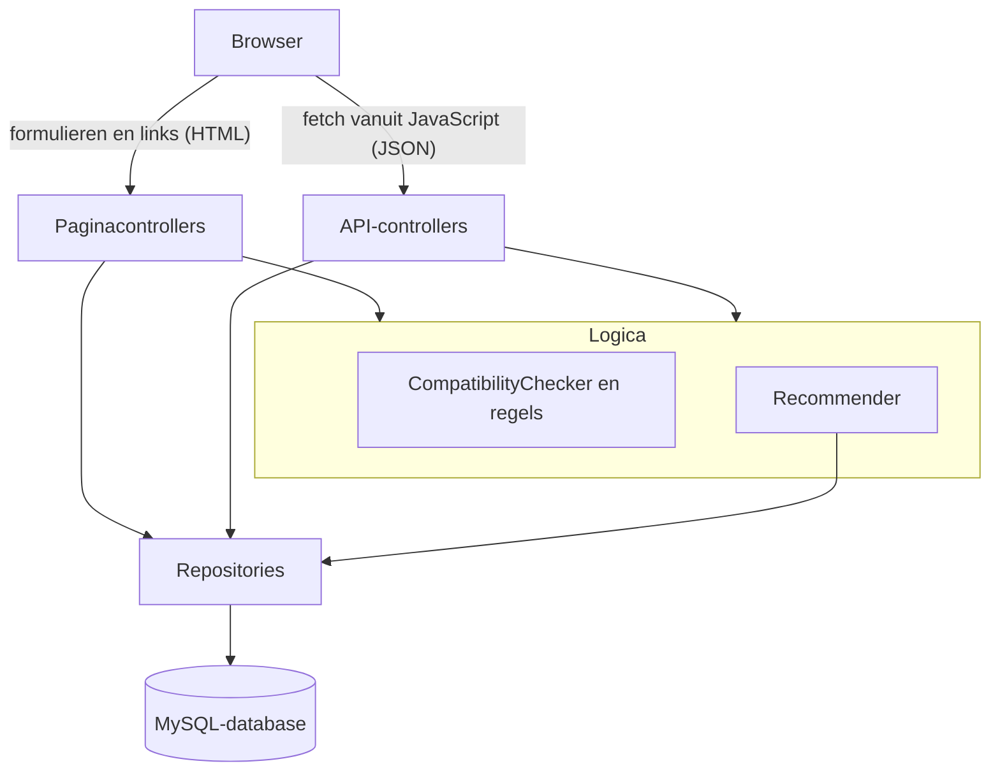
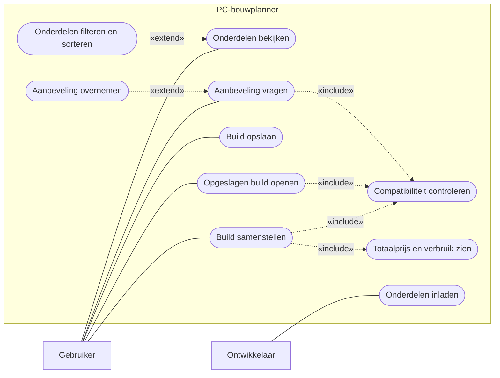
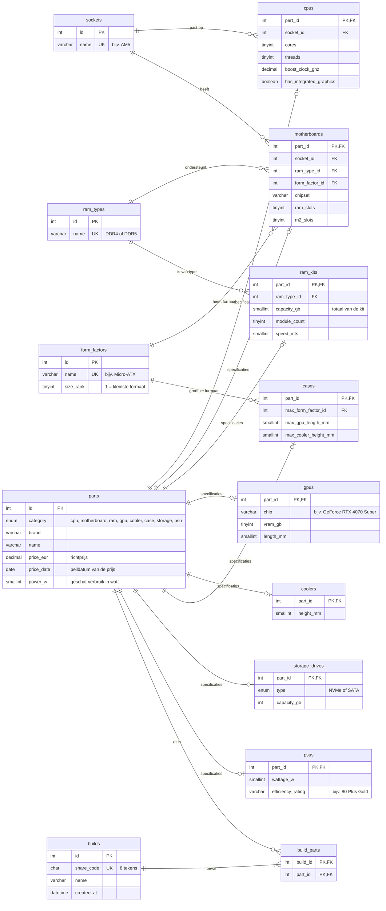
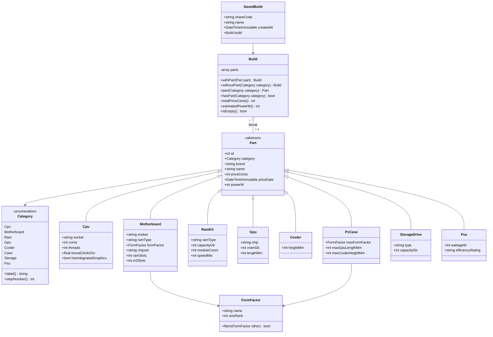
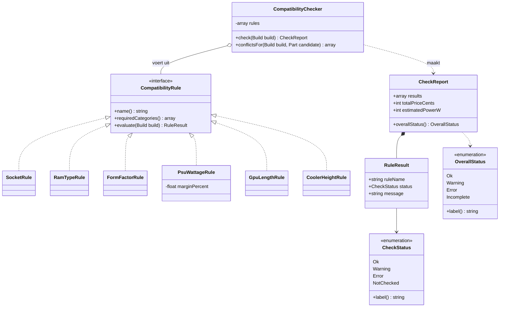
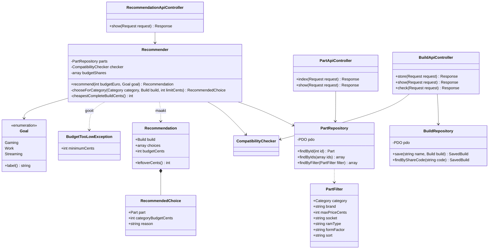
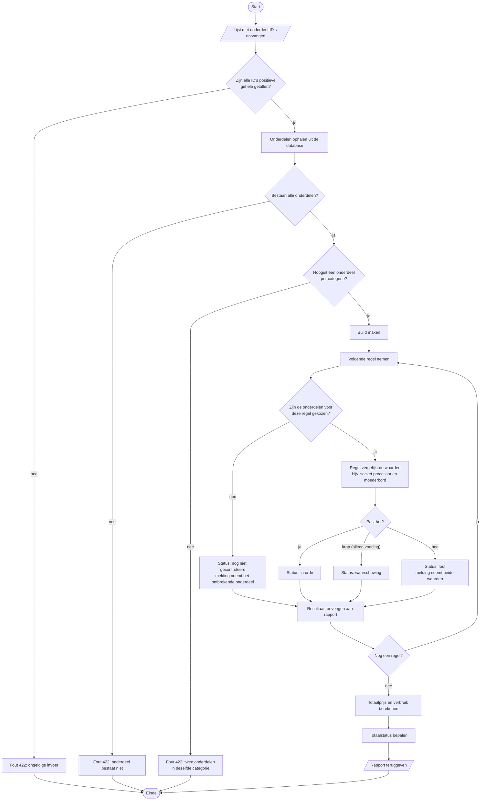
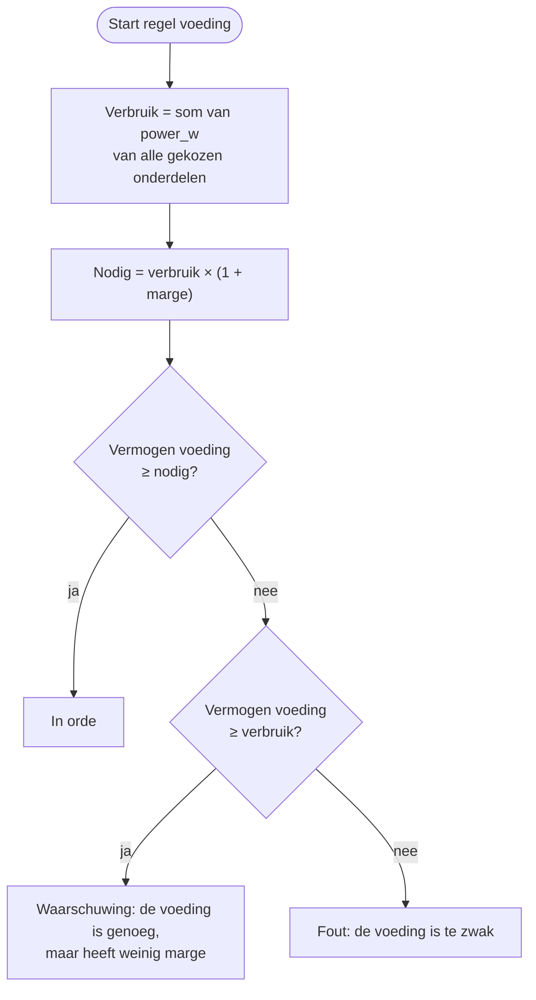

# Technisch ontwerp

In dit document staat hoe de PC-bouwplanner in elkaar zit. De diagrammen zijn gemaakt met Mermaid en staan ook als PNG in [docs/img](img/). De onderbouwing van de keuzes staat in [keuzes.md](keuzes.md).

## 1. Opbouw in lagen

De applicatie heeft twee ingangen: webpagina's voor de gebruiker en een REST API die JSON teruggeeft. Allebei gebruiken ze dezelfde logica, zodat de controle en de aanbeveling maar op één plek staan.



| Laag | Map | Taak |
|---|---|---|
| Ingang | `public/` | `index.php` ontvangt elk verzoek en geeft het aan de router. Ook CSS en het JavaScript-bestand staan hier. |
| Controllers | `src/Http/` | Router, verzoek en antwoord, en de controllers voor pagina's en API. Controllers controleren de invoer en roepen de logica aan. |
| Logica | `src/Compatibility/`, `src/Recommendation/` | Compatibiliteitsregels en de aanbeveling. Deze code kent geen database en geen HTML, daardoor is hij goed te testen. |
| Model | `src/Model/` | Klassen voor onderdelen en een build. |
| Data | `src/Repository/` | Query's naar de database met PDO en prepared statements. |
| Weergave | `templates/` | PHP-templates die de HTML maken. |
| Database | `database/` | `schema.sql` met de tabellen en `seed.php` met de onderdelen. |
| Configuratie | `config/`, `.env` | Databasegegevens, voedingsmarge en budgetverdeling. |
| Tests | `tests/Unit/`, `tests/Api/` | PHPUnit-tests. |

## 2. Usecasediagram

Mermaid heeft geen apart usecasediagram. Daarom is het getekend als stroomschema: de actoren staan buiten het systeem, de use cases zijn de afgeronde vakken binnen het systeem.



| Use case | Eisen | Korte beschrijving |
|---|---|---|
| Onderdelen bekijken | F-02 | De gebruiker ziet per categorie de onderdelen als kaartjes. |
| Onderdelen filteren en sorteren | F-03, F-20 | De gebruiker beperkt de lijst met filters of zet hem op volgorde. |
| Build samenstellen | F-04, F-12 | De gebruiker kiest per stap een onderdeel. Onderdelen die niet passen zijn grijs. |
| Compatibiliteit controleren | F-05 t/m F-11, F-21 | Het systeem voert alle regels uit en geeft per regel een status en melding. |
| Totaalprijs en verbruik zien | F-13 | Het systeem telt prijs en verbruik op na elke keuze. |
| Build opslaan | F-14 | De gebruiker geeft een naam en krijgt een deelcode. |
| Opgeslagen build openen | F-15 | De gebruiker opent een build met de link of de deelcode. |
| Aanbeveling vragen | F-16, F-17 | De gebruiker vult budget en doel in en krijgt een build met uitleg. |
| Aanbeveling overnemen | F-19 | De gebruiker zet de aanbeveling in de bouwplanner om hem aan te passen. |
| Onderdelen inladen | F-01 | De ontwikkelaar vult de database met het seed-script. |

## 3. ERD

Elk onderdeel staat in de tabel `parts` met de gegevens die alle onderdelen hebben: merk, naam, prijs, peildatum en verbruik. De specificaties die per categorie verschillen, staan in een eigen tabel per categorie die met `part_id` aan `parts` vastzit. Sockets, RAM-types en formaten staan in aparte tabellen, zodat een regel nooit faalt door een tikfout zoals `AM5` tegenover `AM5 `.



Toelichting:

- **Prijzen** staan als `DECIMAL(7,2)` in de database. In PHP reken ik in hele centen (`int`), zodat optellen nooit afrondingsfouten geeft.
- **Formaat** heeft een `size_rank`: Mini-ITX = 1, Micro-ATX = 2, ATX = 3, E-ATX = 4. Een kast slaat alleen het grootste formaat op dat erin past. Een moederbord past als zijn `size_rank` kleiner of gelijk is aan die van de kast.
- **Verbruik** (`power_w`) staat bij elk onderdeel. Voor processors en videokaarten is dat het maximale vermogen volgens de fabrikant, voor de andere categorieën een vaste schatting. Zie [keuzes.md](keuzes.md).
- **Build en onderdelen** is een veel-op-veel-relatie via `build_parts`. Dat er per categorie maar één onderdeel in een build zit, controleert de code bij het opslaan.

## 4. Klassendiagram

Het klassendiagram is verdeeld in drie delen, zodat het leesbaar blijft. Alle eigenschappen zijn `readonly`: een onderdeel verandert niet meer nadat het uit de database is geladen.

### 4.1 Onderdelen en build



De klasse voor een kast heet `PcCase`, omdat `case` in PHP een gereserveerd woord is. `withPart` en `withoutPart` geven een nieuwe `Build` terug in plaats van de bestaande te veranderen. Zo kan de controle een onderdeel "proberen" zonder de echte build van de gebruiker aan te passen.

### 4.2 Compatibiliteit



Elke regel is een eigen klasse met dezelfde interface. De `CompatibilityChecker` kijkt eerst met `requiredCategories()` of de onderdelen voor een regel gekozen zijn. Is dat niet zo, dan maakt de checker zelf een resultaat "nog niet gecontroleerd". Pas als alles er is, roept hij `evaluate()` aan. Zo staat de controle op ontbrekende onderdelen maar op één plek. Een nieuwe regel toevoegen (zoals F-21) betekent: één nieuwe klasse schrijven en die aan de lijst van de checker toevoegen.

`conflictsFor()` wordt gebruikt om onderdelen grijs te maken (F-12): de checker voegt het kandidaat-onderdeel toe aan een kopie van de build en geeft de fouten terug van regels waar dat onderdeel bij hoort.

### 4.3 Aanbeveling, opslag en controllers



De paginacontrollers (`BuildPageController`, `RecommendationPageController`) gebruiken dezelfde repositories en logica als de API-controllers, maar geven HTML terug in plaats van JSON.

## 5. Activiteitendiagram compatibiliteitscheck

Dit diagram laat zien wat er gebeurt bij `POST /api/builds/check`. De pagina's doen hetzelfde, alleen komt de lijst met onderdelen dan uit de sessie van de gebruiker.



De totaalstatus volgt uit de resultaten van alle regels, in deze volgorde:

1. Eén of meer regels fout: **fout**.
2. Anders één of meer waarschuwingen: **waarschuwing**.
3. Anders één of meer regels nog niet gecontroleerd: **nog niet compleet**.
4. Anders: **in orde**.

### 5.1 Detail: regel voor de voeding

De voedingsregel is de enige met drie uitkomsten. Daarom staat hij hier apart. De marge staat in `config/app.php` (standaard 30%).



Voorbeeld met 30% marge en een verbruik van 450 W: nodig is 585 W. Een voeding van 650 W is in orde, 500 W geeft een waarschuwing en 400 W een fout. Een voeding van precies 585 W is in orde.

## 6. De zes compatibiliteitsregels

| Regel | Eis | Nodig | In orde als | Voorbeeld van een foutmelding |
|---|---|---|---|---|
| SocketRule | F-05 | processor, moederbord | socket processor = socket moederbord | De processor heeft socket AM5, maar het moederbord heeft socket AM4. |
| RamTypeRule | F-06 | moederbord, geheugen | RAM-type geheugen = RAM-type moederbord | Het geheugen is DDR4, maar het moederbord ondersteunt alleen DDR5. |
| FormFactorRule | F-07 | moederbord, kast | `size_rank` moederbord ≤ `size_rank` grootste formaat kast | Het moederbord is ATX, maar in deze kast past maximaal Micro-ATX. |
| PsuWattageRule | F-08 | voeding, processor | zie 5.1 | De voeding levert 400 W, maar de onderdelen verbruiken samen ongeveer 450 W. |
| GpuLengthRule | F-09 | videokaart, kast | lengte videokaart ≤ maximale lengte kast | De videokaart is 336 mm lang, maar in deze kast past maximaal 305 mm. |
| CoolerHeightRule | F-10 | koeler, kast | hoogte koeler ≤ maximale koelerhoogte kast | De koeler is 168 mm hoog, maar in deze kast past maximaal 155 mm. |

De voedingsregel heeft naast de voeding ook de processor nodig. Zonder processor zou het verbruik heel laag uitvallen en zou elke voeding "in orde" zijn, wat de gebruiker op het verkeerde been zet.

## 7. Aanbeveling

De aanbeveling werkt met vaste regels. Er is geen AI of willekeur: dezelfde invoer geeft altijd dezelfde build.

### 7.1 Budgetverdeling per doel

Het budget wordt per doel over de categorieën verdeeld. Deze percentages staan in `config/app.php`, zodat ik ze kan aanpassen zonder de code te veranderen.

| Categorie | Gamen | Werken | Streamen |
|---|---|---|---|
| Processor | 20% | 32% | 28% |
| Moederbord | 12% | 14% | 12% |
| Geheugen | 8% | 14% | 10% |
| Videokaart | 38% | 10% | 28% |
| Koeler | 4% | 5% | 5% |
| Kast | 6% | 8% | 6% |
| Opslag | 6% | 10% | 6% |
| Voeding | 6% | 7% | 5% |

Daarnaast heeft elk doel minimumeisen:

| Doel | Minimaal geheugen | Minimale opslag |
|---|---|---|
| Gamen | 16 GB | 1000 GB |
| Werken | 16 GB | 500 GB |
| Streamen | 32 GB | 1000 GB |

### 7.2 Stappen

1. Controleer de invoer. Het budget moet een geheel getal groter dan 0 zijn en het doel moet bestaan. Anders volgt een foutmelding.
2. Bereken wat de goedkoopste complete build kost. Is het budget lager, dan stopt de aanbeveling met de melding hoeveel er minimaal nodig is.
3. Kies de onderdelen in deze volgorde: processor, moederbord, geheugen, videokaart, koeler, kast, opslag, voeding. De kast komt na de videokaart en de koeler omdat die er allebei in moeten passen. De voeding komt als laatste, omdat dan het verbruik van alle andere onderdelen bekend is.
4. Per categorie:
   1. **Kandidaten**: alle onderdelen in die categorie die geen fout geven met de onderdelen die al gekozen zijn. Dit gebruikt dezelfde `CompatibilityChecker` als de bouwplanner. Voor geheugen en opslag tellen alleen onderdelen die aan de minimumeisen van het doel voldoen.
   2. **Limiet**: het deelbudget van de categorie, plus wat er bij eerdere categorieën over is gebleven. De limiet is nooit zo hoog dat er voor de categorieën die nog komen geen geld meer is voor het goedkoopste onderdeel.
   3. **Keuze**: het duurste onderdeel dat binnen de limiet valt. Binnen een categorie is een duurder onderdeel meestal sneller of beter. Past er niets binnen de limiet, dan het goedkoopste kandidaat-onderdeel.
   4. **Uitleg**: een zin met de reden, bijvoorbeeld "Gekozen omdat dit de beste videokaart is binnen het deelbudget van € 456 (38% van € 1.200)."
5. Controleer de complete build nog één keer met de `CompatibilityChecker` en kijk of het totaal binnen het budget valt. Geef de build, de uitleg per onderdeel en het overgebleven bedrag terug.

## 8. REST API

Alle antwoorden zijn JSON. Categorieën en doelen gebruiken Engelse waarden, net als de code: `cpu`, `motherboard`, `ram`, `gpu`, `cooler`, `case`, `storage`, `psu` en `gaming`, `work`, `streaming`. Meldingen voor de gebruiker zijn in het Nederlands.

| Methode | Pad | Doel | Invoer | Antwoorden |
|---|---|---|---|---|
| GET | `/api/parts` | Onderdelen ophalen en filteren | query: `category`, `brand`, `max_price`, `socket`, `ram_type`, `form_factor`, `sort` | 200, 422 |
| GET | `/api/parts/{id}` | Eén onderdeel ophalen | | 200, 404 |
| POST | `/api/builds` | Build opslaan | body: `name`, `part_ids` | 201, 400, 422 |
| GET | `/api/builds/{code}` | Opgeslagen build ophalen | | 200, 404 |
| POST | `/api/builds/check` | Build controleren zonder op te slaan | body: `part_ids` | 200, 400, 422 |
| GET | `/api/recommendation` | Aanbeveling opvragen | query: `budget`, `goal` | 200, 422 |

Betekenis van de statuscodes:

| Code | Wanneer |
|---|---|
| 200 | Gelukt. |
| 201 | Build opgeslagen. |
| 400 | De body is geen geldige JSON. |
| 404 | Onderdeel, build of pad bestaat niet. |
| 405 | Het pad bestaat, maar niet met deze methode. |
| 422 | De invoer is wel JSON, maar klopt niet, zoals een onbekende categorie of een budget van 0. |
| 500 | Onverwachte fout op de server. De gebruiker ziet een algemene melding, de details komen in het logbestand. |

Voorbeeld van een controle:

```http
POST /api/builds/check
Content-Type: application/json

{ "part_ids": [3, 12, 21] }
```

```json
{
  "overall_status": "error",
  "total_price_eur": 478.00,
  "estimated_power_w": 212,
  "results": [
    {
      "rule": "socket",
      "status": "error",
      "message": "De processor heeft socket AM5, maar het moederbord heeft socket AM4."
    },
    {
      "rule": "psu_wattage",
      "status": "not_checked",
      "message": "Kies eerst een voeding."
    }
  ]
}
```

Voorbeeld van een foutmelding:

```json
{
  "error": {
    "code": "invalid_budget",
    "message": "Vul een budget in van minimaal 1 euro."
  }
}
```

## 9. Pagina's

| Pad | Pagina |
|---|---|
| `/` | Startpagina met de keuze: zelf samenstellen of een aanbeveling vragen. Ook een veld om een deelcode in te vullen. |
| `/bouwen/{categorie}` | Eén stap van de bouwplanner, met filters en kaartjes. |
| `/overzicht` | Alle gekozen onderdelen, het controleresultaat en het formulier om op te slaan. |
| `/build/{code}` | Een opgeslagen build. |
| `/aanbeveling` | Formulier voor budget en doel, en daaronder het resultaat. |

De build waar de gebruiker mee bezig is, staat in de PHP-sessie. Kiezen en verwijderen gaat met een gewoon formulier (POST). Daarna stuurt de server de browser door naar dezelfde stap, zodat vernieuwen de keuze niet opnieuw verstuurt. Zo werkt alles zonder JavaScript (NF-07).

Er is één klein JavaScript-bestand. Als JavaScript aan staat, verstuurt het de keuze op de achtergrond en haalt het via `POST /api/builds/check` de nieuwe totaalprijs, het verbruik en de status op, zonder dat de pagina opnieuw laadt.

### 9.1 Schermontwerp bouwstap

Desktop:

```text
+--------------------------------------------------------------------------+
| PC-bouwplanner                    Zelf bouwen   Aanbeveling   Build openen |
+--------------------------------------------------------------------------+
| 1 Processor > 2 Moederbord > 3 Geheugen > 4 Videokaart > 5 Koeler > ...   |
+----------------------+---------------------------------------------------+
| Filters              | Stap 2 van 8: Moederbord                          |
|                      |                                                   |
| Merk      [Alle   v] | +-------------+ +-------------+ +-------------+   |
| Max prijs [      ]   | | MSI         | | ASUS        | | Gigabyte    |   |
| Socket    [Alle   v] | | B650 Board  | | B550 Board  | | ...         |   |
| Sorteren  [Prijs  v] | | AM5, DDR5   | | AM4, DDR4   | |             |   |
|                      | | ATX         | | ATX         | |             |   |
| [Filters toepassen]  | | € 189,00    | | € 129,00    | |             |   |
|                      | | [Kies]      | | (grijs)     | |             |   |
|                      | |             | | Past niet:  | |             |   |
|                      | |             | | socket AM4  | |             |   |
|                      | +-------------+ +-------------+ +-------------+   |
+----------------------+---------------------------------------------------+
| Totaal € 478,00  |  Verbruik 212 W  |  Status: nog niet compleet           |
| [< Vorige stap]                                       [Volgende stap >]   |
+--------------------------------------------------------------------------+
```

Telefoon:

```text
+------------------------------+
| PC-bouwplanner        [Menu] |
+------------------------------+
| Stap 2 van 8: Moederbord     |
| [Filters tonen]              |
|                              |
| +--------------------------+ |
| | MSI B650 Board           | |
| | AM5, DDR5, ATX           | |
| | € 189,00          [Kies] | |
| +--------------------------+ |
| +--------------------------+ |
| | ASUS B550 Board  (grijs) | |
| | Past niet: socket AM4    | |
| | € 129,00          [Kies] | |
| +--------------------------+ |
+------------------------------+
| € 478,00 | 212 W | Niet compl. |
| [< Vorige]       [Volgende >] |
+------------------------------+
```

De namen op de kaartjes in deze schetsen zijn voorbeelden. De echte onderdelen komen uit de database.

## 10. Van eis naar ontwerp

| Eis | Waar in het ontwerp |
|---|---|
| F-01 | ERD (§3), `database/seed.php` |
| F-02, F-03, F-20 | `PartRepository`, `PartFilter`, pagina `/bouwen/{categorie}`, `GET /api/parts` |
| F-04 | Pagina's (§9), `Build`, sessie |
| F-05 t/m F-10 | Regels (§6), klassendiagram compatibiliteit (§4.2) |
| F-11 | `CheckReport`, `CheckStatus`, `OverallStatus`, activiteitendiagram (§5) |
| F-12 | `CompatibilityChecker::conflictsFor()` |
| F-13 | `Build::totalPriceCents()`, `Build::estimatedPowerW()`, JavaScript (§9) |
| F-14, F-15 | `BuildRepository`, tabellen `builds` en `build_parts`, `POST /api/builds`, `GET /api/builds/{code}` |
| F-16, F-17 | `Recommender` (§7), `GET /api/recommendation` |
| F-18 | REST API (§8) |
| F-19 | Pagina `/aanbeveling`, sessie |
| F-21 | Extra regel `IntegratedGraphicsRule` (zelfde interface als §4.2) |
| NF-01, NF-02 | Schermontwerp (§9.1), CSS |
| NF-03 | `PartRepository` en `BuildRepository` met prepared statements, escaping in de templates |
| NF-04 | `config/app.php`, `.env` |
| NF-07 | Formulieren met doorsturen na POST (§9) |
